# Граф сюжета «Станция «Тишина»: Жестокий сплав огня и ревности»

> Файл сгенерирован `node tools/build-story.mjs`. Руками не правим — правим `story/story.json`.

**Сцен:** 95 · **переходов:** 179 · **слов:** 808 · **концовок:** 3

✅ Связность в порядке. 

```mermaid
flowchart TD
  start["Шаттл «Кайрос». 06:12"]
  hull["Внешняя обшивка"]
  airlock["Шлюз №3"]
  hello["Шлюз №3"]
  hub["Центральный узел"]
  quarters["Жилой блок"]
  diary["Жилой блок. Аудиодневник"]
  locker["Жилой блок. Шкафчик 9"]
  tunnel["Техтоннель"]
  lira["Техтоннель. Отсек Лиры"]
  lira_truth["Техтоннель. Отсек Лиры"]
  first["Техтоннель. Отсек Лиры"]
  plan["Техтоннель. Отсек Лиры"]
  shaft["Шахта купола"]
  twin_voice["Шахта купола. Дно"]
  twin_voice2["Шахта купола. Дно"]
  bridge["Рубка"]
  kai_truth["Рубка. Разговор с Каем"]
  kai_truth2["Рубка. Разговор с Каем"]
  relay["Сигнальное реле"]
  notebook["Сигнальное реле. Тетрадь"]
  notebook2["Сигнальное реле. Тетрадь"]
  relay_off["Сигнальное реле. Обесточивание"]
  dome["Купол. Вход"]
  sky_crack["Двор. Трещина"]
  schoolyard["Школьный двор. 1 сентября"]
  signs["Коридор первого этажа"]
  gang["Школьный двор. Компания"]
  plan_ignore["Школьный двор"]
  plan_talk["Школьный двор"]
  demid_talk["Школьный двор. Скамейка"]
  demid_talk2["Школьный двор. Скамейка"]
  vanya_meet["Коридор. Встреча с Ваней"]
  vanya_talk["Коридор. Разговор с Ваней"]
  vanya_memory["Коридор. Память Вани"]
  vanya_fight["Двор. Драка"]
  fight_block["Двор. Драка"]
  fight_hit["Двор. Драка"]
  fight_truth["Двор. Клинч"]
  perfect_form["Спортзал. Перфект-форма"]
  artins_talk["Спортзал. Разговор с копией"]
  artins_anger["Спортзал. Ссора"]
  artins_death["Спортзал. Правда Артинса"]
  artins_clash["Спортзал. Первая схватка"]
  artins_grip["Спортзал. Захват"]
  mama_stop["Спортзал. Вмешательство"]
  mama_answer["Спортзал. Ответ МАМЫ"]
  demid_choice["Спортзал. Демид"]
  chapter_end_2["Спортзал. Конец первого круга"]
  last_page["Спортзал. Последняя страница"]
  break_loop["Купол. Разрыв круга"]
  lira_call["Купол. Голос снаружи"]
  act2_final["Спортзал. Люк в полу"]
  act3_start["Огненный зал. Ступени"]
  artins_explain["Огненный зал. Объяснение"]
  artins_terms["Огненный зал. Условия"]
  mama_terms["Огненный зал. МАМА"]
  mama_three["Огненный зал. Три силы"]
  nekit_talk["Огненный зал. Наёмники"]
  nekit_deal["Огненный зал. Сделка"]
  nekit_threat["Огненный зал. Угроза"]
  allies["Огненный зал. Сбор"]
  battle_plan["Огненный зал. План"]
  lira_teleport["Огненный зал. Телепорт"]
  war_council["Огненный зал. Военный совет"]
  artins_hand["Огненный зал. Рукопожатие"]
  act3_final["Огненный зал. Последняя ночь"]
  lira_last["Огненный зал. Лира"]
  kai_last["Огненный зал. Кай"]
  artins_last["Огненный зал. Артинс"]
  dawn["Огненный зал. Рассвет"]
  ch4_teleport["Арена. Телепорт последнего шанса"]
  teleport_refuse["Арена. Телепорт последнего шанса"]
  arena_arrival["Зал огня. Центр арены"]
  act4_start["Огненный зал. Последний час"]
  nekit_first["Арена. Некит"]
  nekit_fight["Арена. Некит"]
  nekit_shadows["Арена. Тени"]
  nekit_memory["Арена. Память Некита"]
  vanya_joins["Арена. Ваня"]
  demid_joins["Арена. Демид"]
  bogdan_turn["Арена. Богдан и Ярик"]
  beast_contract["Арена. Контракт"]
  karina_fire["Арена. Очаг Карины"]
  artins_jealousy["Арена. Ревность"]
  artins_rage["Арена. Ярость"]
  embrace["Арена. Объятие"]
  duel["Арена. Дуэль"]
  karina_call["Арена. Карина"]
  sacrifice_moment["Арена. Момент"]
  mama_ultimatum["Арена. Ультиматум МАМЫ"]
  final_choice["Арена. Последний выбор"]
  ending_ash["Арена. Пепел ⟶ «Пепел»"]
  ending_shard["Арена. Осколок ⟶ «Осколок»"]
  ending_loop["Арена. Сигнал ⟶ «Сигнал»"]
  start --> hull
  start --> airlock
  hull --> airlock
  airlock --> hello
  airlock --> hub
  hello --> hub
  hello --> hub
  hub --> relay
  hub --> quarters
  hub --> tunnel
  hub --> bridge
  quarters --> diary
  quarters --> locker
  quarters --> hub
  diary --> quarters
  locker --> quarters
  tunnel --> lira
  tunnel --> shaft
  tunnel --> hub
  lira --> lira_truth
  lira --> lira_truth
  lira --> hub
  lira_truth --> first
  lira_truth --> plan
  first --> plan
  plan --> hub
  shaft --> twin_voice
  shaft --> twin_voice
  twin_voice --> twin_voice2
  twin_voice --> twin_voice2
  twin_voice2 --> bridge
  twin_voice2 --> bridge
  bridge --> dome
  bridge --> kai_truth
  bridge --> kai_truth
  bridge --> hub
  kai_truth --> kai_truth2
  kai_truth --> kai_truth2
  kai_truth2 --> relay
  relay --> relay_off
  relay --> notebook
  relay --> notebook
  notebook --> notebook2
  notebook2 --> relay
  relay_off --> dome
  relay_off --> bridge
  dome --> schoolyard
  dome --> sky_crack
  sky_crack --> schoolyard
  schoolyard --> gang
  schoolyard --> signs
  signs --> gang
  gang --> plan_ignore
  gang --> plan_talk
  gang --> plan_talk
  plan_ignore --> demid_talk
  plan_talk --> vanya_meet
  plan_talk --> demid_talk
  demid_talk --> demid_talk2
  demid_talk --> vanya_meet
  demid_talk2 --> vanya_meet
  vanya_meet --> vanya_talk
  vanya_meet --> vanya_fight
  vanya_meet --> vanya_fight
  vanya_talk --> vanya_memory
  vanya_talk --> vanya_fight
  vanya_memory --> vanya_fight
  vanya_memory --> vanya_fight
  vanya_fight --> fight_block
  vanya_fight --> fight_hit
  vanya_fight --> fight_truth
  fight_block --> fight_hit
  fight_block --> fight_truth
  fight_hit --> perfect_form
  fight_hit --> perfect_form
  fight_truth --> perfect_form
  perfect_form --> artins_talk
  perfect_form --> artins_talk
  artins_talk --> artins_anger
  artins_talk --> artins_anger
  artins_anger --> artins_clash
  artins_anger --> artins_death
  artins_death --> artins_clash
  artins_clash --> artins_grip
  artins_clash --> demid_choice
  artins_grip --> demid_choice
  artins_grip --> mama_stop
  mama_stop --> mama_answer
  mama_answer --> demid_choice
  mama_answer --> demid_choice
  demid_choice --> chapter_end_2
  demid_choice --> chapter_end_2
  chapter_end_2 --> last_page
  last_page --> break_loop
  break_loop --> lira_call
  break_loop --> lira_call
  lira_call --> act2_final
  act2_final --> act3_start
  act3_start --> artins_explain
  act3_start --> artins_explain
  artins_explain --> artins_terms
  artins_explain --> artins_terms
  artins_terms --> mama_terms
  artins_terms --> mama_terms
  mama_terms --> mama_three
  mama_terms --> mama_three
  mama_three --> nekit_talk
  mama_three --> nekit_talk
  nekit_talk --> nekit_deal
  nekit_talk --> nekit_deal
  nekit_deal --> nekit_threat
  nekit_deal --> nekit_threat
  nekit_threat --> allies
  nekit_threat --> allies
  allies --> battle_plan
  allies --> battle_plan
  allies --> battle_plan
  allies --> battle_plan
  battle_plan --> lira_teleport
  battle_plan --> lira_teleport
  lira_teleport --> war_council
  lira_teleport --> war_council
  war_council --> artins_hand
  war_council --> artins_hand
  artins_hand --> act3_final
  act3_final --> lira_last
  act3_final --> kai_last
  act3_final --> artins_last
  lira_last --> dawn
  lira_last --> dawn
  kai_last --> dawn
  kai_last --> dawn
  artins_last --> dawn
  artins_last --> dawn
  dawn --> act4_start
  ch4_teleport --> arena_arrival
  ch4_teleport --> teleport_refuse
  teleport_refuse --> ch4_teleport
  arena_arrival --> nekit_first
  act4_start --> ch4_teleport
  act4_start --> nekit_first
  nekit_first --> nekit_fight
  nekit_first --> nekit_fight
  nekit_fight --> nekit_shadows
  nekit_fight --> vanya_joins
  nekit_fight --> demid_joins
  nekit_shadows --> nekit_memory
  nekit_shadows --> nekit_memory
  nekit_memory --> bogdan_turn
  nekit_memory --> bogdan_turn
  vanya_joins --> bogdan_turn
  vanya_joins --> nekit_memory
  demid_joins --> bogdan_turn
  demid_joins --> bogdan_turn
  bogdan_turn --> karina_fire
  bogdan_turn --> beast_contract
  beast_contract --> karina_fire
  beast_contract --> karina_fire
  karina_fire --> artins_jealousy
  karina_fire --> artins_jealousy
  artins_jealousy --> artins_rage
  artins_jealousy --> artins_rage
  artins_jealousy --> artins_rage
  artins_rage --> embrace
  artins_rage --> duel
  artins_rage --> karina_call
  embrace --> mama_ultimatum
  duel --> sacrifice_moment
  duel --> sacrifice_moment
  karina_call --> mama_ultimatum
  karina_call --> mama_ultimatum
  sacrifice_moment --> mama_ultimatum
  sacrifice_moment --> mama_ultimatum
  mama_ultimatum --> final_choice
  mama_ultimatum --> final_choice
  mama_ultimatum --> final_choice
  final_choice --> ending_ash
  final_choice --> ending_shard
  final_choice --> ending_loop
  classDef act1 fill:#3b82f622,stroke:#3b82f6,stroke-width:2px,color:#e5e7eb
  classDef act2 fill:#a855f722,stroke:#a855f7,stroke-width:2px,color:#e5e7eb
  classDef act3 fill:#f59e0b22,stroke:#f59e0b,stroke-width:2px,color:#e5e7eb
  class start act1
  class hull act1
  class airlock act1
  class hello act1
  class hub act1
  class quarters act1
  class diary act1
  class locker act1
  class tunnel act1
  class lira act1
  class lira_truth act1
  class first act1
  class plan act1
  class shaft act1
  class twin_voice act1
  class twin_voice2 act1
  class bridge act1
  class kai_truth act1
  class kai_truth2 act1
  class relay act1
  class notebook act1
  class notebook2 act1
  class relay_off act1
  class dome act2
  class sky_crack act2
  class schoolyard act2
  class signs act2
  class gang act2
  class plan_ignore act2
  class plan_talk act2
  class demid_talk act2
  class demid_talk2 act2
  class vanya_meet act2
  class vanya_talk act2
  class vanya_memory act2
  class vanya_fight act2
  class fight_block act2
  class fight_hit act2
  class fight_truth act2
  class perfect_form act2
  class artins_talk act2
  class artins_anger act2
  class artins_death act2
  class artins_clash act2
  class artins_grip act2
  class mama_stop act2
  class mama_answer act2
  class demid_choice act2
  class chapter_end_2 act2
  class last_page act2
  class break_loop act2
  class lira_call act2
  class act2_final act2
  class act3_start act3
  class artins_explain act3
  class artins_terms act3
  class mama_terms act3
  class mama_three act3
  class nekit_talk act3
  class nekit_deal act3
  class nekit_threat act3
  class allies act3
  class battle_plan act3
  class lira_teleport act3
  class war_council act3
  class artins_hand act3
  class act3_final act3
  class lira_last act3
  class kai_last act3
  class artins_last act3
  class dawn act3
  class ch4_teleport act4
  class teleport_refuse act4
  class arena_arrival act4
  class act4_start act4
  class nekit_first act4
  class nekit_fight act4
  class nekit_shadows act4
  class nekit_memory act4
  class vanya_joins act4
  class demid_joins act4
  class bogdan_turn act4
  class beast_contract act4
  class karina_fire act4
  class artins_jealousy act4
  class artins_rage act4
  class embrace act4
  class duel act4
  class karina_call act4
  class sacrifice_moment act4
  class mama_ultimatum act4
  class final_choice act4
  class ending_ash act4
  class ending_shard act4
  class ending_loop act4
```

## Концовки

| id | Название | Тип | Как получить |
|---|---|---|---|
| `ash` | Пепел | bad | `ending_ash` |
| `shard` | Осколок | neutral | `ending_shard` |
| `loop` | Сигнал | true | `ending_loop` |

## Проверки

Все проверки пройдены: нет висячих ссылок, тупиков, недостижимых сцен и «нестреляющих ружей».

