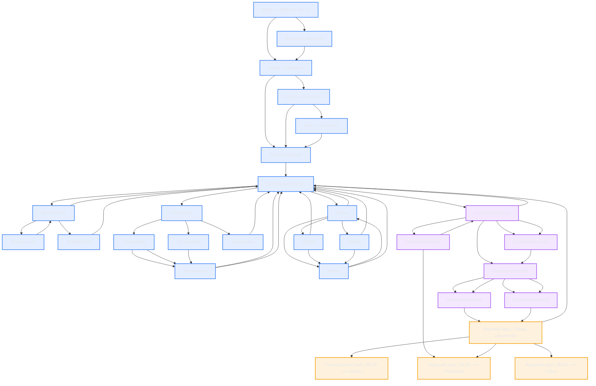

# Граф сюжета «Станция «Тишина»»

> Файл сгенерирован `node tools/build-story.mjs`. Руками не правим — правим `story/story.json`.

**Сцен:** 29 · **переходов:** 55 · **слов:** 882 · **концовок:** 3

✅ Связность в порядке. 

## Концовки

| id | Название | Тип | Как получить |
|---|---|---|---|
| `light` | Свет | neutral | `ending_light_seq` |
| `silence` | Тишина | bad | `ending_silence_seq` |
| `echo` | Эхо | true | `ending_echo_seq` |

## Проверки

Все проверки пройдены: нет висячих ссылок, тупиков, недостижимых сцен и «нестреляющих ружей».

